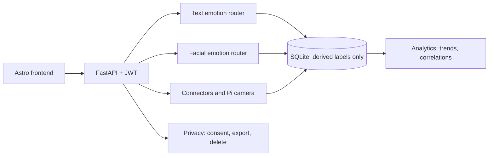

<div align="center">

# MindfulAI

**A privacy-first, multi-modal mental wellness tracker.**

    

[](https://github.com/adineo-cmd/mindfulai/stargazers) [](https://github.com/adineo-cmd/mindfulai/commits)

[Quick start](#quick-start) · [How it works](#how-it-works) · [Features](#features)

</div>

---

MindfulAI reads three signals — what you write, what your face shows, and what
you report yourself — and turns them into a trend you can actually look at.

Text emotion uses a fine-tuned DistilRoBERTa model; facial emotion uses a Vision
Transformer over a WebSocket webcam stream. Only derived labels are stored:
**raw video and audio are never persisted.**

> This is a wellness tool and a final-year academic project, not a substitute
> for diagnosis, therapy or clinical care.

## Features

| | Feature | What it does |
| --- | --- | --- |
| 📝 | **Text emotion** | Seven-class emotion classification over journal entries. |
| 📷 | **Live facial signal** | Webcam frames classified at one inference per second, never recorded. |
| 📈 | **Trends and correlations** | Mood, emotion and self-report joined over time, with heatmaps. |
| 🔐 | **Consent and export** | Explicit consent records, plus CSV and PDF export of your own data. |

## How it works

Three signals meet in one backend:

1. The Astro frontend calls the FastAPI API with a JWT.
2. Text and facial routers run their transformer pipelines and store derived
   labels.
3. Analytics joins labels, mood logs and self-reports into trends,
   correlations and a risk score.
4. Privacy routes own consent, export and deletion; connectors and the Pi camera
   feed the same pipeline.

The design and its positioning against Woebot, Wysa and Tess are written up in
`paper/main.tex`.



## Quick start

**Backend**

```bash
cd backend
python3 -m venv venv && source venv/bin/activate
pip install -r requirements.txt
cp .env.example .env
uvicorn app.main:app --reload --port 8000
```

**Frontend**

```bash
cd frontend
npm install
cp .env.example .env          # PUBLIC_API_BASE_URL=http://localhost:8000
npm run dev                   # http://localhost:4321
```

## Project structure

```text
backend/
  app/            FastAPI app, routers, models
  download_models.py  model fetcher
  setup.sh        environment bootstrap
frontend/
  src/pages/      dashboard, journal, live check, trends, settings
paper/            LaTeX research paper
```

## Configuration

| Variable | Default | Purpose |
| --- | --- | --- |
| `DATABASE_URL` | `sqlite:///./mindfulai.db` | Application database |
| `SECRET_KEY` | change in production | JWT signing |
| `FRONTEND_URL` | `http://localhost:4321` | Allowed frontend origin |
| `OLLAMA_BASE_URL` | `http://localhost:11434` | Reserved for the roadmap companion |
| `OLLAMA_MODEL` | `tinyllama` | Companion model name |

## Deployment

`.github/workflows/ci.yml` runs the backend lint and test suite plus the frontend
checks on every push and pull request.

The UI is not deployed to GitHub Pages. Run the backend and frontend locally as
shown above and point `PUBLIC_API_BASE_URL` at the backend.

## Research paper

*MindfulAI: A Privacy-First Multi-Modal Framework for Emotion-Aware Mental
Wellness Support* lives in `paper/main.tex`. Build it with:

```bash
tectonic paper/main.tex
```

## License

GNU GPL-3.0. See [LICENSE](LICENSE).
